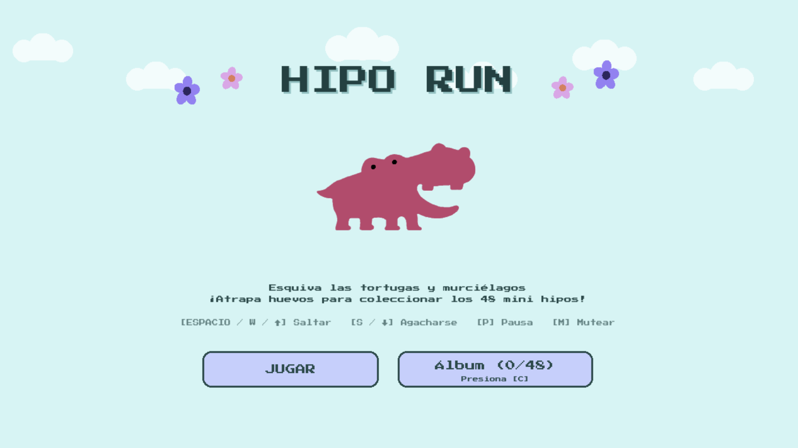
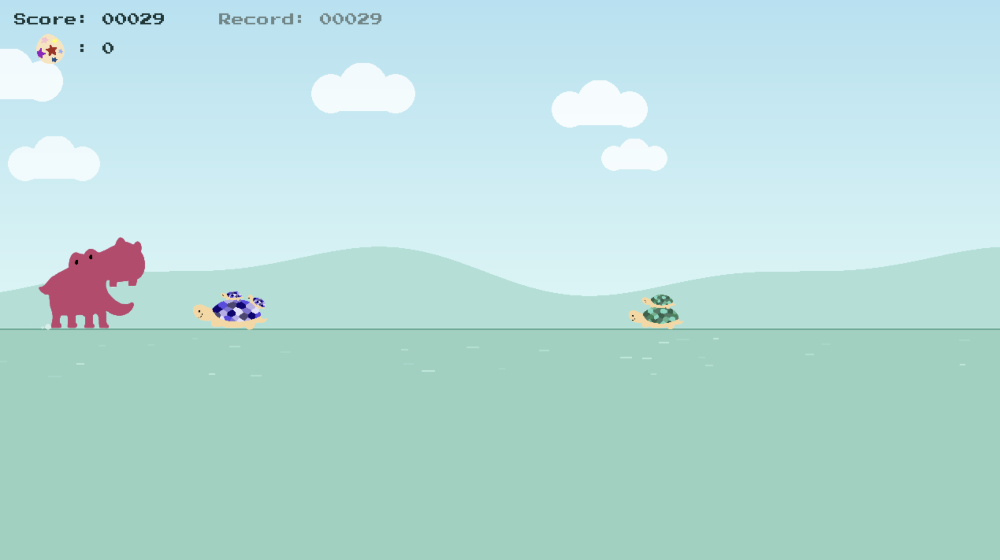
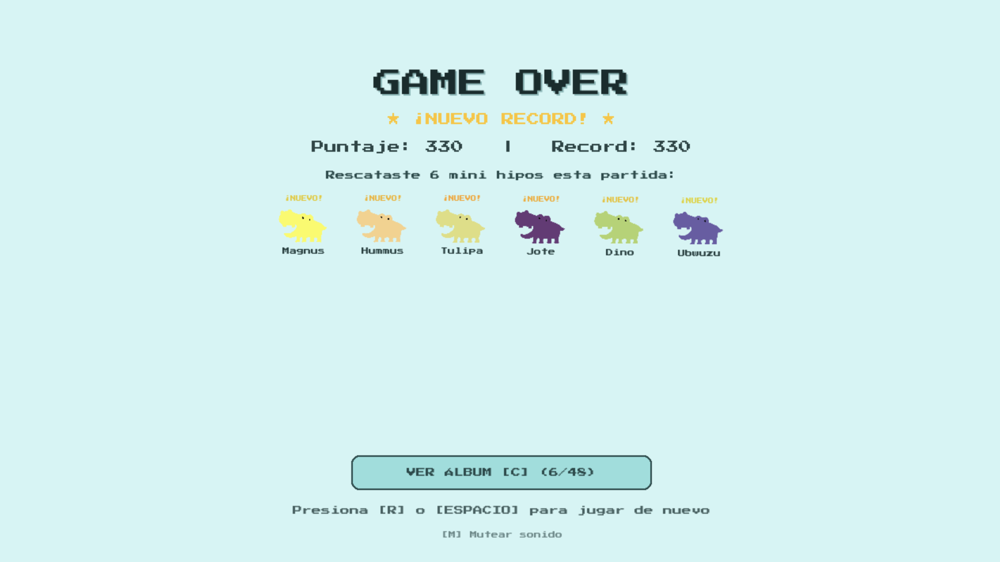
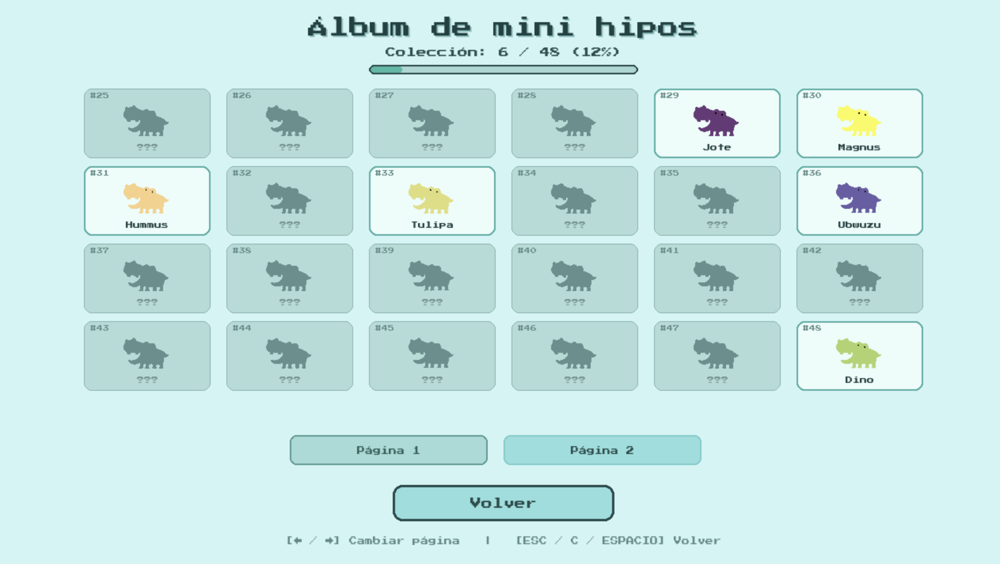

# Mini Juego Hipo Run

Juego tipo *infinite runner* desarrollado en Pygame, en el que debes esquivar obstáculos de tortugas y murciélagos con Hipo.

La dificultad va aumentando progresivamente a medida que avanzas en el juego. 
Atrapa los huevos mágicos para obtener puntos extras y rescatar a los 48 mini hipos coleccionables.

## Screens

1. Pantalla de inicio
<p align="center">
    
</p>

2. Pantalla de juego
<p align="center">
    
</p>

3. Pantalla de *game over*
<p align="center">
    
</p>

4. Pantalla de colección de mini hipos
<p align="center">
    
</p>

## Instalación 

1. Clona este repositorio:
```bash
git clone https://github.com/Dafna-konig/Hipo-Run.git
```

2. Navega hasta la carpeta del proyecto:
```bash
cd Hipo-Run
```

3. Crea un entorno virtual y actívalo:

    Para Windows:
    ```bash
    python -m venv venv
    venv\Scripts\activate
    ```
    Para Mac / Linux:
    ```bash
    python3 -m venv venv
    source venv/bin/activate
    ```

4. Instala Pygame:
```bash
pip install pygame
```

5. Corre el juego:
```bash
python hipo.py
```

## Controles

| Acción | Teclas |
| :--- | :--- |
| **Saltar** (altura variable) | <kbd>Espacio</kbd>, <kbd>Flecha Arriba</kbd> ($\uparrow$), o <kbd>W</kbd> |
| **Agacharse / Caída rápida** | <kbd>Flecha Abajo</kbd> ($\downarrow$), o <kbd>S</kbd> |
| **Álbum / Colección de Mini Hipos** | <kbd>C</kbd> o clic en el botón del menú |
| **Pausar / Reanudar** | <kbd>P</kbd> o <kbd>ESC</kbd> |
| **Mutear / Activar sonido** | <kbd>M</kbd> |
| **Reiniciar partida** | <kbd>R</kbd>, <kbd>Espacio</kbd> o clic |
| **Ver hitboxes (Debug)** | <kbd>F3</kbd> o <kbd>H</kbd> |

¡Intenta conseguir la mayor cantidad de puntos y rescatar a los 24 mini hipos para completar tu álbum!
