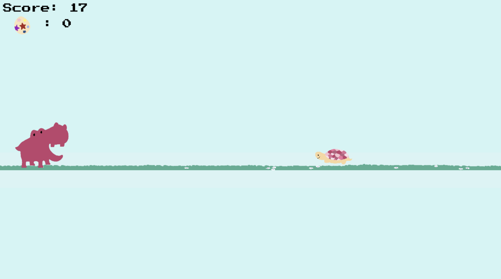
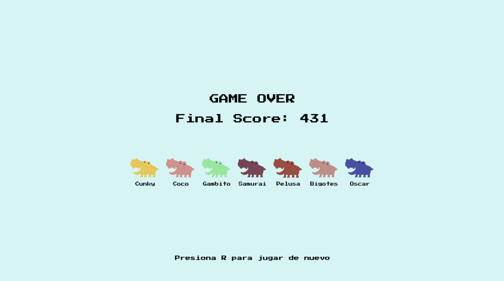

## Mini Juego con Pygame 

Implementación de runner infinito en que se tienen que esquivar los obstáculos de tortugas y murciélagos. 
Va aumentando la dificultad a medida que progresa el juego. 
Atrapa los huevos mágicos para obtener puntos extras y mini hipos.

